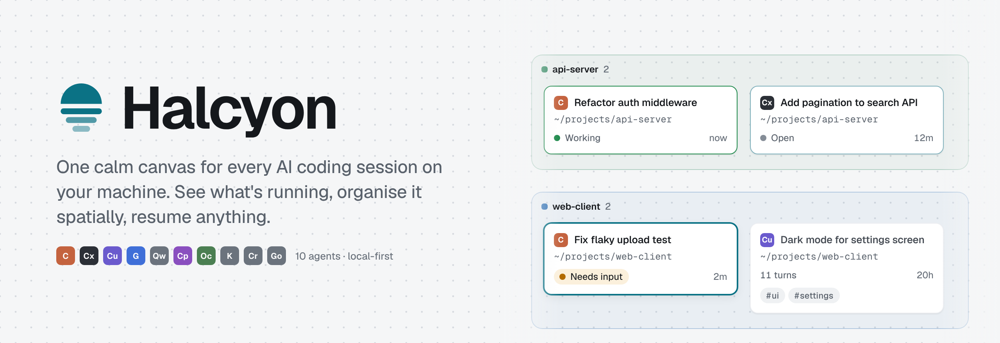
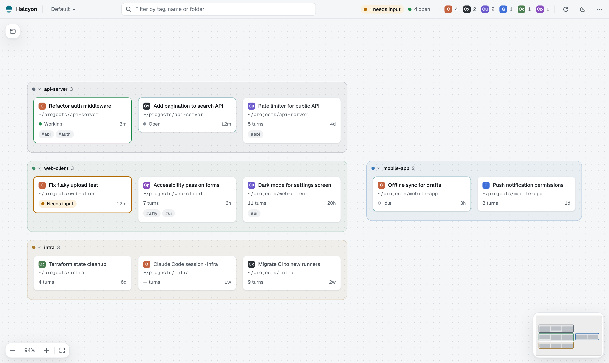
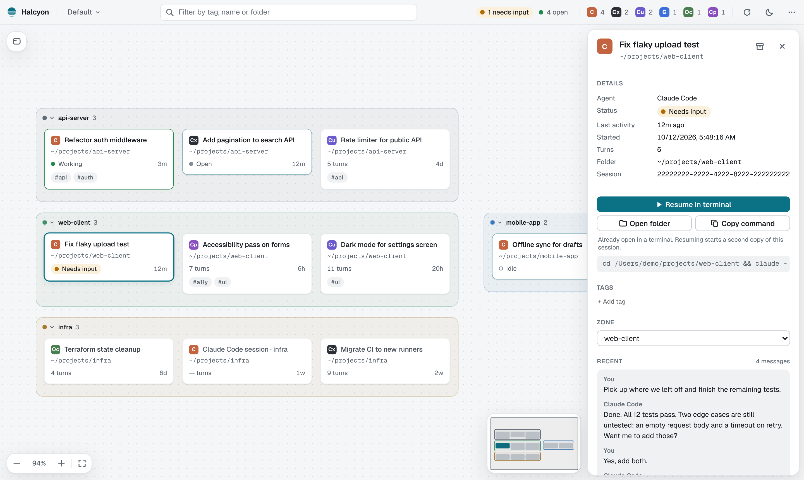
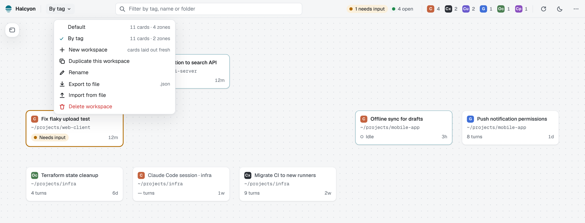
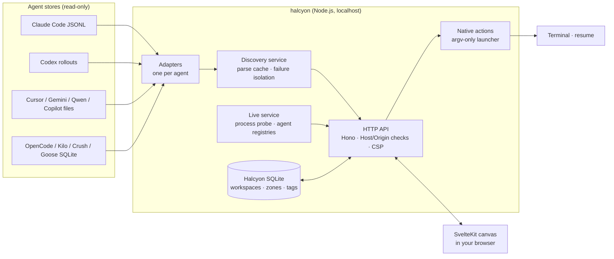

<p align="center">
  <picture>
    <source media="(prefers-color-scheme: dark)" srcset="docs/assets/banner-dark.png">
    
  </picture>
</p>

<p align="center">
  <b>Local-first</b> · <b>No account, no API key</b> · <b>Read-only on your agents' files</b> · <b>10 coding agents</b>
</p>

<p align="center">
  <a href="LICENSE"></a>
  
</p>

---

Halcyon finds the AI coding sessions already on your machine — Claude Code, Codex, Cursor, Gemini, Copilot and more — and lays them out as cards on one infinite canvas. You see which ones are working or waiting for you, group them into zones, tag them, and jump back into any of them in its own terminal and folder.

It doesn't replace your agents or wrap their terminals. It reads the session files they already keep, never changes them, and hands you back to the native CLI when you want to continue.

- [Quick start](#quick-start)
- [Why Halcyon](#why-halcyon)
- [Features](#features)
- [Supported agents](#supported-agents)
- [Using Halcyon](#using-halcyon)
- [Privacy and safety](#privacy-and-safety)
- [How it works](#how-it-works)
- [Development](#development)
- [Status and limitations](#status-and-limitations)
- [Contributing](#contributing)
- [Licence](#licence)

## Quick start

**Requirements:** Node.js **22.17 or newer** (Halcyon uses the built-in `node:sqlite`). macOS and Linux are fully supported; on Windows everything except *Resume in terminal* works (copy the command instead).

```bash
npx halcyon-ai               # run without installing
npm install -g halcyon-ai    # or install the `halcyon` command
halcyon
```

### From source

Building from source also needs [pnpm](https://pnpm.io) 10.

```bash
git clone https://github.com/sarupurisailalith/Halcyon.git
cd Halcyon
pnpm install
pnpm build
pnpm start            # or: node packages/server/dist/cli.js
```

Halcyon starts on `http://127.0.0.1:4317` (or the next free port) and opens your browser. Press `Ctrl+C` to stop it.

To install the `halcyon` command globally from a local build:

```bash
pnpm --filter halcyon-ai run package     # writes packages/server/release/halcyon-ai-<version>.tgz
npm install -g packages/server/release/halcyon-ai-*.tgz
halcyon
```

Want to look around first without touching your own sessions? Run the demo:

```bash
node packages/server/dist/cli.js --fixtures
```

### Command-line options

| Option | Description |
|---|---|
| `-p, --port <n>` | Port to listen on (default `4317`; tries the next few if busy, unless a port is given) |
| `--no-open` | Don't open a browser |
| `--fixtures` | Show synthetic demo sessions instead of real ones (actions never start a process) |
| `--data-dir <dir>` | Where Halcyon keeps its database (default `~/.halcyon`, or `$HALCYON_HOME`) |
| `-h, --help` | Show help |

## Why Halcyon

If you run several coding agents across several projects, the sessions pile up: a Claude Code refactor in one repo, a Codex migration in another, a Cursor chat you meant to come back to. Each CLI has its own list, scoped to its own folder, and none of them can tell you what's running *right now* across all of them.

Halcyon gives you one calm place to see the whole picture:

- **What exists** — every session from every supported agent, discovered automatically.
- **What's live** — which sessions are working, which need your input, which are just open.
- **Where it belongs** — your own spatial organisation: zones, tags, named workspaces.
- **How to get back** — one click to resume a session in a terminal, in the right folder.

## Features

<picture>
  <source media="(prefers-color-scheme: dark)" srcset="docs/assets/canvas-dark.png">
  
</picture>

**Canvas**
- Infinite, trackpad-first canvas: two-finger scroll pans, pinch zooms toward the cursor, cards stay crisp at every zoom with a compact level of detail when zoomed out.
- Every session is a card: agent, title, folder, live status or turn count, last activity, tags.
- Drag cards anywhere; positions persist. Shift-click or shift-drag to select several and move them together.
- Minimap, fit-all, keyboard navigation, light and dark themes.

**Organisation**
- **Zones** — coloured containers that hold cards in a tidy grid and grow to fit. A session sits in at most one zone per workspace. Collapse a zone to its label, rename it inline, create one from a selection.
- **Group by project** — one zone per git repository (or folder) in one click; new sessions from that project flow into its zone automatically.
- **Tags** — any number per session, with a filter bar that highlights or isolates matches and can turn a filter into a zone.
- **Arrange by tag** — one zone per tag, with Undo.
- **Named workspaces** — keep several arrangements of the same sessions (by project, by tag, "this sprint"), switch between them from the top bar, duplicate one to experiment.
- **Export / import** — save a workspace to a JSON file and bring it back as a new workspace (backup, or move between machines).
- **Rename** a session's display name in Halcyon only; **archive** sessions you don't need to see (nothing is deleted, and a toggle shows them again).

**Live status**
- Working (pulsing green), **Needs input** (amber — the one state designed to catch your eye), Idle and Open, taken only from signals the agents publish themselves. Halcyon never guesses from file activity.
- Card borders carry the state; sessions that aren't running fade gently the longer they've been idle.
- The top bar counts open sessions and sessions waiting for you, and filters to them in one click; the tab title shows how many need input.

<picture>
  <source media="(prefers-color-scheme: dark)" srcset="docs/assets/sidebar-dark.png">
  
</picture>

**Details and actions**
- A non-blocking sidebar with status, timestamps, turns, folder and session ID, plus a short preview of the most recent messages — read from the transcript on demand and never stored.
- **Resume in terminal** opens a new terminal window in the session's folder and runs the agent's own resume command. **Open folder** and **Copy command** are one click away.
- Long paths, IDs and commands scroll instead of being cut off.

<picture>
  
</picture>

## Supported agents

Halcyon reads each agent's own local store, lists only top-level sessions you could resume (subagents, archived and empty sessions are skipped, as the agent's own list does), and resumes with the agent's documented command in the session's folder.

| Agent | Where Halcyon looks | Resume command | Live status |
|---|---|---|---|
| **Claude Code** | `~/.claude/projects/*/<id>.jsonl` | `claude --resume <id>` | Working · Needs input · Idle (Claude Code's session registry) |
| **Codex CLI** | `~/.codex/sessions/YYYY/MM/DD/rollout-*.jsonl` | `codex resume <id>` | Open (rollout file held by a running `codex`) |
| **Cursor CLI** | `~/.cursor/chats/<md5(cwd)>/<id>/` + agent transcripts | `cursor-agent --resume <id>` | — |
| **Gemini CLI** | `~/.gemini/tmp/<project>/chats/session-*` | `gemini --resume <id>` | — |
| **Qwen Code** | `~/.qwen/projects/<cwd>/chats/<id>.jsonl` | `qwen --resume <id>` | Open (Qwen's session registry) |
| **GitHub Copilot CLI** | `~/.copilot/session-state/<id>/` | `copilot --resume <id>` | Open (in-use lock) |
| **OpenCode** | `~/.local/share/opencode/opencode.db` | `opencode <dir> --session <id>` | — |
| **Kilo Code CLI** | `~/.local/share/kilo/kilo.db` | `kilo <dir> --session <id>` | — |
| **Crush** | projects in `~/.local/share/crush/projects.json` → `crush.db` | `crush -c <dir> -s <id>` | — |
| **Goose** | `~/.local/share/goose/sessions/sessions.db` | `goose session --resume --session-id <id>` | — |

"—" means the agent publishes no live signal, so Halcyon shows last activity instead of guessing. Agents you don't have installed are listed as "not found" in the **⋯** menu and otherwise stay out of the way.

Each agent's usual environment overrides are honoured, for example `CLAUDE_CONFIG_DIR`, `CODEX_HOME`, `CURSOR_CONFIG_DIR` / `CURSOR_DATA_DIR`, `GEMINI_CLI_HOME`, `QWEN_HOME`, `COPILOT_HOME`, `OPENCODE_DB`, `KILO_DB`, `CRUSH_GLOBAL_DATA`, `GOOSE_PATH_ROOT` and `XDG_DATA_HOME` / `XDG_CONFIG_HOME` / `XDG_STATE_HOME`.

## Using Halcyon

On first launch Halcyon scans every supported agent and places your sessions on the canvas, grouped by project. The banner offers **Group by project** to put them in zones straight away.

### Mouse and trackpad

| Gesture | Result |
|---|---|
| Two-finger scroll / wheel | Pan (switch to *Scroll wheel zooms* in the ⋯ menu if you use a mouse) |
| Pinch, or ⌘/Ctrl + scroll | Zoom toward the cursor |
| Drag empty canvas | Pan |
| Space + drag | Pan from anywhere, even over cards |
| Drag a card | Move it; drop inside a zone to put it there, on open canvas to take it out |
| Shift-click / shift-drag | Select several cards; drag any of them to move them all |
| Drag a zone label | Move the zone and its cards |
| Double-click a card or zone name | Rename it |
| Click a card | Open its details |

### Keyboard

| Key | Action |
|---|---|
| `/` | Focus the filter |
| `+` / `-` | Zoom in / out |
| `0` | Zoom to 100% |
| `1` | Fit everything |
| `F` | Focus the selected card |
| `N` | New zone |
| `Enter` | Open the focused card |
| `Esc` | Close the sidebar, then clear selection and filters |

### Workspaces

The workspace name in the top bar opens the switcher. A workspace holds **layout**: card positions, zones, camera and saved filter. **Tags, display names and archive state are shared** across all workspaces, so tagging a session once makes it available everywhere. *New workspace* lays every card out fresh; *Duplicate* copies the current layout so you can rearrange freely; *Export* and *Import* move a workspace through a JSON file. The default workspace can't be deleted.

### Live status

| State | Meaning |
|---|---|
| ● **Working** | The agent is running a turn |
| ● **Needs input** | The agent is waiting for you, for example to approve a tool |
| ○ **Idle** | Open in a terminal, waiting for your next prompt |
| ● **Open** | A process holds the session, but the agent reports no more detail |
| *Closed* | No running process holds the session (shown only for agents that can tell) |

Resuming a session that's already open starts a second copy; the sidebar warns you when that's the case.

## Privacy and safety

Session transcripts can contain secrets, so Halcyon is deliberately conservative:

- **Local only.** The server binds to `127.0.0.1`, checks the `Host` header on every request and the `Origin` on every write (protecting against DNS rebinding and cross-site requests), and sends a strict Content-Security-Policy. No telemetry, no cloud service, no account, no API key. Fonts are bundled.
- **Read-only on your agents.** Halcyon never writes to, moves or deletes any agent's files. SQLite stores are opened read-only. Archiving and renaming happen only in Halcyon's own database.
- **Minimal parsing.** Only the fields a card needs (IDs, folders, timestamps, provider-stored titles, counts) are read and cached. Message text is never stored; the sidebar preview is read on request, bounded in size, and stripped of injected system context.
- **No shell interpolation.** Native actions launch executables with argument arrays. Session IDs are validated per agent (UUIDs or safe tokens that can never start with `-`) and folders are checked before anything runs.
- **Your data:** Halcyon's own database lives at `~/.halcyon/halcyon.db` (or `$HALCYON_HOME`). Delete the folder to reset it.

The full details are in [PRIVACY.md](PRIVACY.md). To report a vulnerability, see [SECURITY.md](SECURITY.md).

## How it works



- **Adapters** (`packages/server/src/adapters/<agent>/`) each implement one contract from `packages/core`: `detect`, `scan`, `resumeCommand`, an optional bounded `preview`, and an optional `live` check. They fail independently — one broken store never hides another agent's sessions — and distinguish "not installed" from "no sessions" from "scan failed".
- **Discovery** streams JSONL, tolerates truncated last lines, and caches parsed metadata by file size and modification time, so large transcripts aren't re-read.
- **Live status** comes from what the agents publish (Claude Code's and Qwen's session registries, files held open by running processes), checked with `ps` and `/proc` or `lsof` — never inferred from a recent file write.
- **Provider data and user data are separate.** Agent metadata is a replaceable cache; workspaces, zones, placements, tags, titles and archive state are yours, in versioned SQLite migrations.

### Repository layout

```
apps/web/                 SvelteKit 2 SPA (Svelte 5) — canvas, sidebar, design system in src/lib/design
packages/core/            Shared contracts: sessions, IDs, adapter interface, API types
packages/server/          CLI + Hono server, adapters, discovery, live status, SQLite stores, native actions
  src/adapters/<agent>/   One folder per supported agent
  test/                   Vitest suites with synthetic fixtures
docs/assets/              README images (banner source in docs/assets/src)
```

### HTTP API

The UI talks to a small JSON API on the same localhost port. All writes require the Halcyon origin.

| Endpoint | Purpose |
|---|---|
| `GET /api/sessions` · `POST /api/sessions/refresh` | Sessions and per-agent health |
| `GET /api/live` | Running sessions and their state |
| `GET /api/sessions/:id/preview` | Bounded recent messages (never cached) |
| `GET /api/sessions/:id/command` · `POST …/resume` · `POST …/open-folder` | Native actions |
| `PUT /api/sessions/:id/tags` · `PUT …/title` · `PUT /api/sessions/archive` | Tags, display names, archive |
| `GET /api/workspaces` · `POST` · `PATCH /:id` · `DELETE /:id` | Workspace list and management |
| `GET /api/workspaces/:id/export` · `POST /api/workspaces/import` | Export / import |
| `GET /api/workspace` · `PUT …/placements` · `…/viewport` · `…/filter` · `…/zones` | Layout of one workspace (`?workspace=<id>`) |

## Development

```bash
pnpm install
pnpm build                       # core + server + web, then bundles the UI into the server
pnpm test                        # Vitest across all packages
pnpm typecheck                   # tsc + svelte-check
node packages/server/dist/cli.js --no-open --fixtures    # API + built UI on :4317 with demo data
pnpm --filter web dev            # Vite dev server for the UI (proxies /api to :4317)
```

**Adding an agent:** create `packages/server/src/adapters/<agent>/<agent>-adapter.ts` implementing `ProviderAdapter`, add the provider ID and its native-ID rule in `packages/core`, register it in `adapters/index.ts`, and give it a label and monogram in `apps/web/src/lib/format.ts`. Tests use invented fixtures only — never real transcripts — and should cover malformed and truncated input, skipped subagent/empty sessions, a missing store, resume argv and preview bounds. The existing adapters are good templates: Claude (JSONL), Copilot (event log + YAML), OpenCode (SQLite).

**Design system:** the UI follows the Halcyon design system. Its tokens and `hc-*` component styles are vendored in `apps/web/src/lib/design/`; regenerate `tokens.css` with `pnpm --filter web tokens` rather than editing it, and use tokens and `hc-*` classes instead of ad-hoc colours or sizes. Type is Geist and Geist Mono; the mark is the *Horizon* — a low sun over still water whose reflections double as stacked session cards.

## Status and limitations

Halcyon is early software, built and used daily by one developer.

- **Verified on real machines:** discovery, live status and one-click resume for Claude Code; discovery and live presence for Codex.
- **Built against the agents' current formats but not yet exercised on real sessions:** Cursor CLI, Gemini CLI, Qwen Code, Copilot CLI, OpenCode, Kilo Code, Crush and Goose. Their storage formats are undocumented and change between releases; adapters are written to fail soft (an agent shows as "scan failed" rather than breaking the canvas). Please open an issue with your agent version if one misbehaves.
- **Live status** exists only where the agent publishes a signal (see the table above). Copilot's in-use lock detection is unverified.
- **Not included:** cloud sync, multiple users, cost analytics, or sending prompts into sessions. An optional oversight agent (exposing Halcyon to one of your own coding agents over MCP, with every action confirmed by you) is planned.
- **Not supported:** agents that keep sessions only in the cloud (Amp) or have no resumable sessions (Aider).

## Contributing

Bug reports, agent-support reports and pull requests are welcome. Start with [CONTRIBUTING.md](CONTRIBUTING.md); it covers setup, the pull-request checklist and how to add an agent. Please never attach real session files to an issue — describe the folder layout and field names instead. Everyone taking part follows the [code of conduct](CODE_OF_CONDUCT.md). Changes are recorded in [CHANGELOG.md](CHANGELOG.md).

## Licence

Halcyon is licensed under the [Apache License 2.0](LICENSE). Copyright 2026 Sailalith Sarupuri; see [NOTICE](NOTICE).

It bundles the Geist and Geist Mono typefaces (SIL Open Font License 1.1) and a few MIT-licensed packages, listed with their licences in [THIRD_PARTY_NOTICES.md](THIRD_PARTY_NOTICES.md). Halcyon is an independent project, not affiliated with or endorsed by the makers of any agent it supports; their names are used only to identify them.

---

<p align="center"><sub>Halcyon — after the <i>halcyon days</i>: still water, clear light. The halcyon is a kingfisher, hence the teal.</sub></p>
